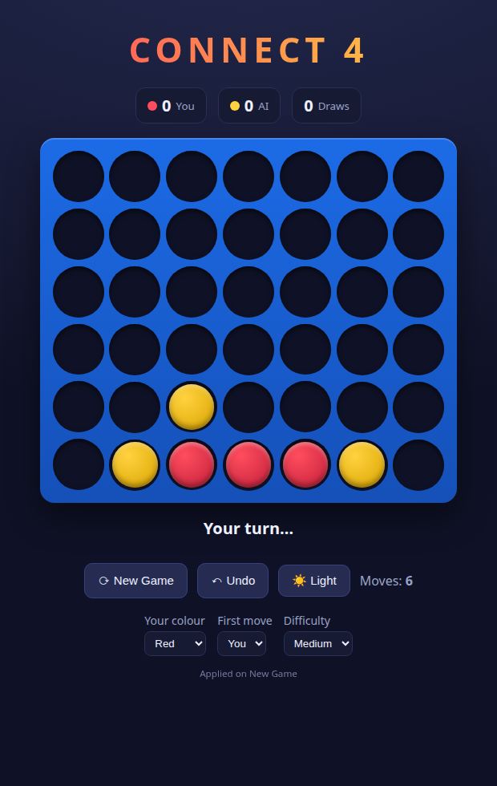

# Connect 4 Solver

A browser Connect 4 game against a minimax AI. You play in the frontend;
a Python/Flask backend validates each move, computes the AI's reply with
alpha–beta minimax, and sends it back.



## Features

- Play vs. an alpha–beta minimax AI
- **Choose your colour** (red/yellow — cosmetic) and **who moves first** (you or the AI)
- **Difficulty** selector → AI search depth (Easy 2 / Medium 4 / Hard 6)
- **Undo**, **New Game**, move counter, and a win/loss/draw **scoreboard** (saved in `localStorage`)
- **Light / dark theme** toggle (saved in `localStorage`)
- Animated piece drops, column hover highlight, and winning-line glow

## Tech stack

- **Frontend:** vanilla HTML/CSS/JS, no build step
- **Backend:** Python 3 + Flask + Flask-CORS, served with gunicorn in production

## Project structure

```
backend/
  engine.py          Flask app + minimax engine (single file)
  requirements.txt
frontend/
  index.html         page shell; board is built in JS
  script.js          game loop, controls, theme, API calls
  style.css          dark/light themes (CSS variables)
  assets/            piece/slot PNGs (unused by current CSS-disc UI)
```

## How it works

The backend is **stateless**: the frontend holds the authoritative board and
sends it on every move. For each request the server:

1. Validates the board (shape, no floating pieces, piece-count parity, not already won).
2. Drops the human piece and checks for a win/draw.
3. If the game continues, picks the AI move via `best_move` → `minimax`
   (alpha–beta, center-first move ordering) and checks again.
4. Returns both pieces and the game status.

**Board encoding:** 6×7 grid, row 0 at the top, cells are `'.'`, `'R'`
(human), or `'Y'` (AI). The AI is always `'Y'` internally regardless of the
colour you pick on screen.

## API

### `POST /api`

**Request**

| Field | Type | Notes |
|-------|------|-------|
| `col_num` | int 1–7, or `null` | Column to drop into. `null` = "AI plays the opening move" (only valid on an empty board with `human_first: false`). |
| `board` | 6×7 array | Current board of `'.'`/`'R'`/`'Y'`. |
| `depth` | int | AI search depth, clamped to 1–8. Defaults to the server's `depth_config`. |
| `human_first` | bool | Whether the human moves first. Controls board-parity validation. Defaults `true`. |

**Response**

```json
{
  "status": 200,
  "human_piece": [row, col],
  "game_status": -1,
  "cols_height_human": [0,0,0,1,0,0,0],
  "ai_piece": [row, col],
  "game_status_now": -1,
  "cols_height_ai": [0,1,0,1,0,0,0]
}
```

- `human_piece` / `ai_piece`: `[row, col]` of the placed piece, or `[-1, -1]` if none.
- `game_status`: status after the human move. `game_status_now`: status after the AI move.
  - `-1` ongoing · `0` draw · `1` human won · `2` AI won
- `cols_height_*`: per-column fill heights after each move.

**Status codes**

| Code | Meaning |
|------|---------|
| 200 | OK |
| 601 | Column is full |
| 602 | Invalid move (bad column / malformed opening request) |
| 603 | Board is corrupted (bad symbol or floating piece) |
| 604 | Board is full |
| 605 | Piece-count parity mismatch |
| 606 | Game is already over |

### `GET /`

Health check — returns `"Live"`.

## Running locally

**Backend**

```bash
cd backend
python3 -m venv .venv
source .venv/bin/activate
pip install -r requirements.txt
python engine.py            # serves on http://localhost:5000 (override with PORT)
```

**Frontend**

`frontend/script.js` points `API` at the deployed backend. To run fully
local, change that constant to your local backend, then serve the folder:

```bash
cd frontend
python3 -m http.server 5500   # open http://localhost:5500
```

## Deployment

- **Backend:** gunicorn, e.g. `gunicorn engine:app` (Render / any WSGI host).
  `PORT` is read from the environment.
- **Frontend:** any static host; set the `API` constant in `script.js` to the
  backend URL.

## Configuration

- `depth_config` in `engine.py` is the default AI depth when a request omits
  `depth`. Higher = stronger but slower — the minimax is plain (no
  transposition table), so depth 7+ can take seconds on a small host.
